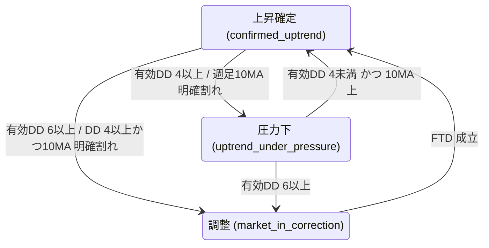

# 市場ステート仕様

指数ごとに、O'Neil / IBD の原典に沿った3状態で相場の地合いを判定する (#117)。
判定は I/O を持たない純関数 (`scripts/market_state.py`) で、閾値は同モジュールの定数、遷移ルールの全体は `derive_state` の docstring を正とする。
永続化は市場DBの各指数 dict (`market_state` / `state_meta` / `state_history`) で行う。

## 3つの状態

初回 (前日の状態が無い) は、その日の有効DD数だけで3状態のどれかに置く (10MA の補助ルールは使わない)。

## 判定に使う事象

| 事象 | 定義 |
|---|---|
| ディストリビューションデイ (DD) | 前日比 -0.2% 以下 かつ 出来高が前日より多い日 |
| ストーリングデイ | 52週高値の97%以上の水準で、微増 (0〜+0.4%)・出来高増・日足の下半分で引けた日。DD として数える |
| DD の失効 | 25取引日が経過した、または指数が DD 発生日の終値の1.05倍以上に戻した。取得窓から外れた DD も失効扱い (古い DD が残って状態が張り付かないように) |
| DD の数え直し | FTD で上昇確定に戻ったら、その FTD 以前の DD は数えない (原典どおり)。残すと、FTD の直後に「DD 4以上かつ10MA 割れ」で調整へ戻る |
| ラリーアテンプト | 調整中に前日より高く引けた日を Day 1 とし、その安値を記録する。Day 1 の安値を割ったら取り消す |
| フォロースルーデイ (FTD) | ラリー Day 4 以降に、+1.0% 以上 かつ 出来高が前日より多い日 |
| 週足10MA 明確割れ | 週足10MA からの乖離が -1% 以下。日足50MA の代わりに使う (10週 ≈ 50営業日) |

## 対象指数

TOPIX / グロース250 (DB キーは `mothers`) / 日経225 / NASDAQ / S&P500。各指数が独立に状態を持つ。
運用総額の目標 (`exposure_guide.py`、#593) には使わない。表示と日次ログに残し、保有額で加重した市場ステートが前回の点検より悪化したら保有の点検 (#589) のきっかけにする。調整に入ったときは、点検で「調整入りの点検」(逆指値・線に近い玉・新しい買いの約束・維持率で売る順番) も行う ([2026-11-27 の判断](../decisions/2026-11-27-市場ステートは量に加えず調整入りの点検で傷の経路を塞ぐ.md))。

## 検証で分かったこと (2026-11-15)

判定ロジックを日経225・NASDAQ・S&P500 の2006年以降の日足 (各約5,000営業日) で再生した。TOPIX とグロース250 は長期の出来高つきデータが無く、対象外。再生は本番と完全には一致しない (直近30日の一致は S&P500 30/30日、日経225 24/29日、NASDAQ 12/30日)。

- **指数のその後のリターンは状態で分かれない。** 翌日リターンの年率は、上昇確定 +4〜10%、調整 +12〜27% (全期間 +10〜14%)。20日後・60日後で見ても同じ
- **調整の日数は全体の31〜40%、調整入りは年3〜4回。** FTD の後60日以内に調整へ戻らなかったのは21〜27%
- **高値から15%以上の下落19回のすべてで調整が出た。** 最初に出た時点の下落は高値から0〜−17%
- **状態どおりに持ち高を変えると (上昇確定100%・圧力下50%・調整0%)、最大下落は浅くなるがリターンの大半を失う。** 日経225 は年率 +6.9% → +2.9%、最大下落 −61% → −32%。米国は「50日線の上だけ持つ」に劣る
  - 2026-11-27 に測り直した ([資金管理の検証](../投資メモ分析/レビュー/資金管理の検証_2026-11.md) の 6): これは平均の持ち高が約6割の極端な案を 100% と比べた結果だった。「調整なら 0.8倍まで」は、平均倍率が近い一定 1.0倍より年率・最悪の1か月が良く、すぐ戻る急落 (コロナ・関税) で日経VI より効く。本番の直近30日との一致は 27/30 (調整入りが3営業日早い)。1週遅らせると、VI に重ねた版は年率が 0.5pt 下がる
- **自分の売買 (決済済みの買い367件、2024年12月〜2026年11月) をエントリー前日の状態 (日経225) で分けると、** 上昇確定は平均 +6.1%・勝率53%、調整は平均 +1.5%・勝率48%。ただし差は2025年 (上昇確定 +12.1%、調整 +1.2%) が作っており、2026年は上昇確定が −0.9% で逆転した。エントリーの頻度は状態で変わっていなかった (調整の日数比34%、エントリーの35%)

読み方: 指数の先行きを当てる道具ではなく、大きな下落の序盤で出る警告として使う。運用比率の上限に使う位置づけ (#480) はこの強みに合う。調整は期間の3〜4割を占めるので、「調整だから買わない」を厳密に守ると機会の多くを捨てる。

FTD で DD を数え直す修正 (同日) の前は、調整の日数が全体の43〜51%、FTD の後60日以内に調整へ戻らなかったのは10〜17%だった。

## 採用しなかった案

| 案 | 理由 |
|---|---|
| 調整のあいだ運用総額を 0.8倍までに抑える (日経VI に重ねる) | すぐ戻る急落の傷は浅くなるが、本番の遅れを見込むと年率で 0.5pt ほど払う。下げが続く暴落は VI と口座の上限で受け持つので、量ではなく調整入りの点検にした (2026-11-27) |
| ボラティリティ連動の FTD 閾値 (200日HV で 0.7〜1.245%) | 日足データを大きく延ばす必要があり、効果に見合わない。固定 1.0% で運用する |
| 個別銘柄のシグナルに市場ステートを反映する (`[ブ?]` / `[ブ!]` など) | ユーザー判断で実装しない。市場表示の精度向上に振り替えた |
| 日足50MA による遷移 | 日足データの延長が要るため、週足10MA で代替した |
| Minervini Breadth (トレンドテンプレート通過銘柄数) | 見送り (#167)。週足から過去51週を再現すると、通過率は TOPIX の40週線乖離と相関 0.86、新高値−新安値と 0.67 で、先行性もなかった。既存の市場指標では市場の質が判断できないと感じたときに再検討する |
